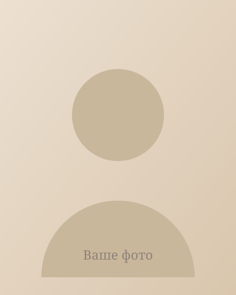

# БезПерсон — сайт психологині

Односторінковий сайт-портфоліо для психологині та її проєкту **БезПерсон** —
групи психологічної підтримки. Статичний сайт (HTML + CSS + трохи JS), без бекенду,
готовий до безкоштовного хостингу на **GitHub Pages**.

## 📁 Структура

```
BezPerson/
├── index.html        ← Головна (герой, підхід, з чим працюю, послуги, дихальна вправа)
├── about.html        ← Про мене (про психологиню, освіта, сертифікати, відгуки)
├── bezperson.html    ← БезПерсон (про групу, формати, правила, розклад, анонімне запитання)
├── contact.html      ← Контакти (форма, контакти, поширені запитання)
├── styles.css        ← спільне оформлення для всіх сторінок (кольори, шрифти)
├── script.js         ← меню, анімації, дихальна вправа, рік у підвалі
├── .nojekyll         ← щоб GitHub Pages віддавав файли як є
└── assets/
    ├── photo-placeholder.svg   ← тимчасове фото
    ├── cert-placeholder.svg    ← тимчасовий сертифікат
    ├── favicon.svg             ← іконка вкладки
    └── certs/                  ← сюди кладемо зображення сертифікатів
```

## ✏️ Що потрібно замінити (шукайте текст у `[ квадратних дужках ]`)

Тексти тепер розкидані по сторінках — ось де що шукати:

- **Про мене** (`about.html`) — абзаци «Про мене», блок «Освіта / Напрям / Досвід», сертифікати, відгуки.
- **З чим працюю / Послуги** (`index.html`) — за потреби відкоригуйте список і ціну `- грн`.
- **Розклад і анонімне запитання** (`bezperson.html`) — дати та теми зустрічей, `[ПОСИЛАННЯ]` на Zoom, `[ПОСИЛАННЯ НА TELEGRAM-ГРУПУ]`, `YOUR_QUESTIONS_FORM_ID`.
- **Контакти** (`contact.html`) — форма (`YOUR_FORM_ID`), посилання на Telegram/email, ціна у FAQ.
- **Контакти** у підвалі кожної сторінки:
  - Telegram: `https://t.me/[username]`
  - Email: `mailto:[email@example.com]`
  - Instagram: `https://instagram.com/[username]` (або приберіть рядок)
- **Посилання на Telegram-групу** — `[ПОСИЛАННЯ НА TELEGRAM-ГРУПУ]` у секції БезПерсон.
- **Відгуки** — додайте реальні анонімні відгуки.

### Фото
Покладіть фото як `assets/photo.jpg`, тоді у `index.html` змініть:
```html

<!-- на -->

```

### Сертифікати
1. Покладіть зображення у `assets/certs/` (напр. `cert-1.jpg`, `cert-2.jpg`…).
2. У секції «Сертифікати» замініть `assets/cert-placeholder.svg` на свій файл
   та оновіть підпис `[Назва сертифіката]`.
3. Додавайте/видаляйте блоки `<a class="cert-item">…</a>` за кількістю сертифікатів.

### Форми (контакти + анонімні запитання)
Форми працюють через **Google Форми**: дані зберігаються у вашому власному
Google-акаунті (у Google-таблиці), без сторонніх сервісів. Без ліміту, безкоштовно.
Візуально це наші форми в стилі сайту — дані тихо надсилаються у приховану Google-форму.

**Контактна форма** під'єднана до форми `…/1FAIpQLSdKSkQ…/formResponse`,
**анонімні запитання** — до `…/1FAIpQLSew5pSyp…/formResponse` (див. `contact.html` та `bezperson.html`).

Як під'єднати **іншу** Google-форму:
1. Створіть Google-форму з потрібними полями. У налаштуваннях вимкніть «Збирати
   електронні адреси» та «Обмежити до 1 відповіді» (щоб надсилати без входу в Google).
2. Відкрийте форму (`…/viewform`), у коді сторінки візьміть:
   - адресу надсилання — `…/formResponse` (замість `/viewform`);
   - ID кожного поля — `entry.XXXXXXXX`.
3. У формі на сайті підставте цей `action` та `name="entry.XXXXXXXX"` для кожного поля
   (вони мають відповідати полям Google-форми).

Відповіді дивіться у Google Формах → вкладка «Відповіді» (можна вивести у Google-таблицю).

## 🚀 Публікація на GitHub Pages

1. Створіть репозиторій на GitHub (напр. `bezperson`).
2. Завантажте всі файли цієї теки в репозиторій (через сайт GitHub або `git`).
3. У репозиторії: **Settings → Pages**.
4. У розділі **Build and deployment → Source** оберіть **Deploy from a branch**.
5. Branch: **main**, тека: **/ (root)** → **Save**.
6. За хвилину-дві сайт буде доступний за адресою
   `https://ВАШ-НІК.github.io/bezperson/`.

### Через git (за бажанням)
```bash
git init
git add .
git commit -m "Перша версія сайту БезПерсон"
git branch -M main
git remote add origin https://github.com/ВАШ-НІК/bezperson.git
git push -u origin main
```

### Власний домен (опційно)
Якщо матимете свій домен (напр. `bezperson.com.ua`) — його можна підключити
у **Settings → Pages → Custom domain**.

## 👀 Переглянути локально
У теці проєкту:
```bash
python3 -m http.server 8000
```
Відкрийте http://localhost:8000
